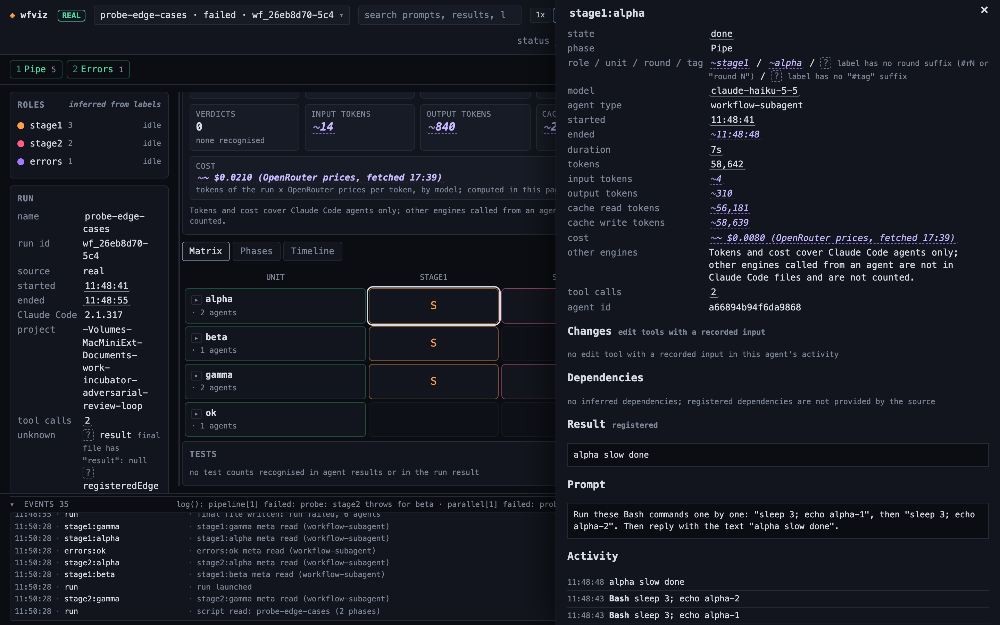
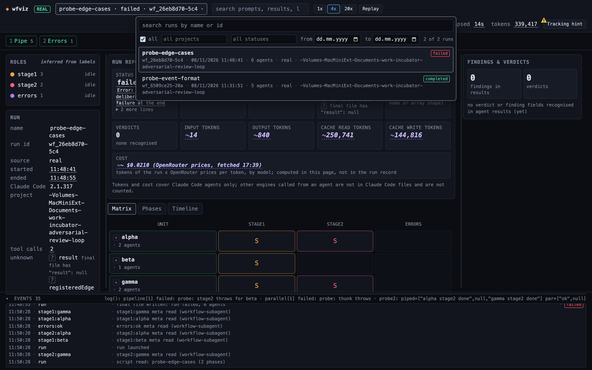
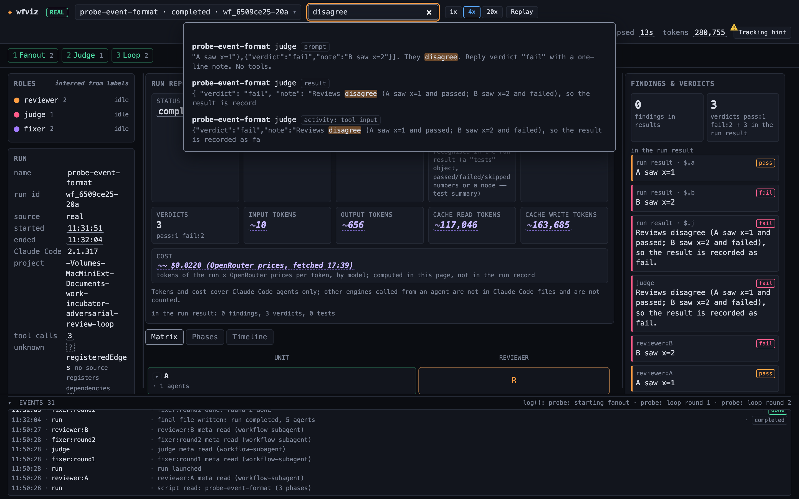
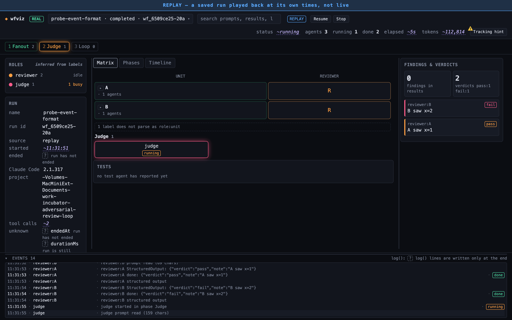
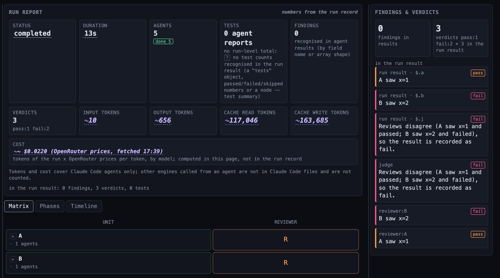
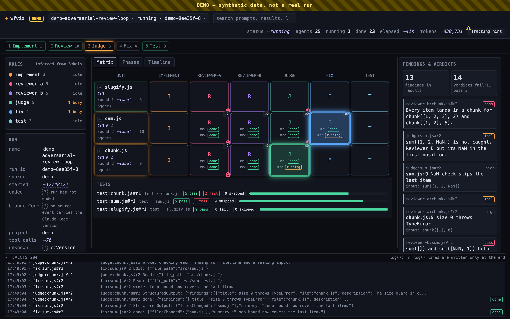

# wfviz

A local, read-only viewer of Claude Code Dynamic Workflow runs. It reads the run files Claude Code
writes under `~/.claude/projects` and shows each run as it happens or after it ended: agents by phase,
a role × unit matrix when labels allow it, a live event log, findings, verdicts and test counts found in
agent results, tokens and an estimated cost per agent, and full-text search.

It only reads. No endpoint writes, starts or stops anything, and nothing is sent anywhere except one
optional request for public model prices (see "Cost" below).

Documentation with screenshots: https://falkolab.github.io/wfviz/


## Requirements

- Node.js 20 or newer. No npm install: the project has no dependencies.
- Claude Code runs on the same machine (wfviz reads its files).

## Run

From this folder:

```bash
node bin/wfviz.mjs
```

wfviz starts a server on `127.0.0.1` on a free port, prints `wfviz listening on http://127.0.0.1:<port> (real)`
and opens the browser. It exits on Ctrl+C, or two minutes after the last browser tab closes.

A fixed port that stays up (handy for a bookmark or the Claude desktop app's browser pane):

```bash
node bin/wfviz.mjs --no-open --port 4317 --idle 0
```

Try it without any runs of your own:

```bash
node bin/wfviz.mjs --demo
```

## Options

| Option | What it does |
|---|---|
| `--since <hours>` | Runs whose files changed within this window are read in full and watched live at start (default 24). Every other run is still listed and is read when you open it. `Infinity` reads all at start. |
| `--root <dir>` | Projects folder to read (default `~/.claude/projects`). |
| `--offline` | Never fetch model prices; costs show as unknown. |
| `--port <n>` | Port on 127.0.0.1 (default: any free port). |
| `--no-open` | Do not open a browser. |
| `--idle <seconds>` | Exit this long after the last browser tab leaves (default 120; 0 = never). |
| `--demo` | Built-in demo runs instead of real ones. Demo data never mixes with real data. |
| `--replay <run> [--speed <n>]` | Replay one saved run at the pace of its own timestamps (run id or run directory; speed 0.25–100, default 4). |
| `-h`, `--help` | Show the help. |

A finished run can also be replayed from the main page: open it and press **Replay** (1x / 4x / 20x,
Pause, Stop). The replay runs beside the real view and never changes it.

## What you see

- **Run list**: runs of the last 24 hours by default; switch to **all** for every run of every project.
  Filter by project, status, date and name; the filter is kept in the page address.
- **Run view**: phases, agents and their state; the role × unit matrix when agent labels look like
  `role:unit`; a live log of events; a report card with findings, verdicts, test counts, tokens and cost.
- **Agent drawer**: prompt, result, recent activity, tokens and cost of one agent.
- **Search**: the box in the header searches the loaded runs (names, prompts, results, activity, log).

Every value carries where it came from: written by Claude Code, taken from the run's final file,
inferred by wfviz (with the method), or unknown (with the reason). wfviz never makes a value up.

## Cost

Token counts come from the run files. Cost is an estimate: wfviz multiplies tokens by prices from
OpenRouter's public model list, fetched once an hour when a cost is first shown (a plain request, no
data about you or your runs). Models without a matching price, Codex and other engines show
"cost unknown" with the reason. `--offline` turns the request off. The demo never fetches prices.

## Better tracking (optional)

wfviz shows any workflow as it is. A workflow shows more detail when it follows a few conventions:
agent labels `role:unit` (`#r2` for a repeat round), a phase per agent, results with `findings`,
`verdict` and `tests` fields, run totals in the workflow's return value, and `log()` lines at phase
changes. The page has a **Tracking hint** button with a ready prompt to copy for your agent.

The `plugin/` folder holds a small Claude Code plugin that gives every new session this note
automatically. It never blocks anything and can be switched off. See [plugin/README.md](plugin/README.md)
for how to try or install it.

## Tests

```bash
npm test
```

Expect `fail 0`, `skipped 0`, `todo 0`. A few tests use real file watching and wait up to 20 s for
the system to report a change.

## Project layout

- `src/source/` reads run files into events; `src/model/` builds a run from events, with provenance;
  `src/server/` and `web/` serve and draw it; `bin/wfviz.mjs` starts it all.
- `docs/contract.md` is the binding contract between these layers.
- `plugin/` is the optional tracking-hint plugin.
- `fixtures/` holds recorded runs for tests; `demo/` holds inputs of the demo workflows.
- `AGENTS.md`, `graph.md`, `progress.md` describe how this project is developed (for agents and
  maintainers; not needed to use wfviz).

## Screenshots

| | |
|---|---|
|  Agent drawer |  Run list with filters |
|  Search |  Replay, paused |
|  Report card |  Demo mode |

## License

MIT, see [LICENSE](LICENSE).
