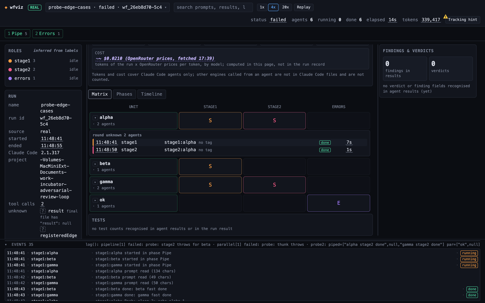

# wfviz

A local, read-only viewer of Claude Code Dynamic Workflow runs. It reads the run files Claude Code
writes under `~/.claude/projects` and shows each run as it happens or after it ended: agents by phase,
a role × unit matrix when labels allow it, a live event log, findings, verdicts and test counts found in
agent results, tokens and an estimated cost per agent, and full-text search.

wfviz only reads. Its server listens on `127.0.0.1` only and has no endpoint that writes, starts or stops
anything. The one request it makes to the internet is optional: public model prices (see "Cost").

Documentation with screenshots: https://falkolab.github.io/wfviz/



## Requirements

- Node.js 20 or newer. No dependencies, nothing to install.
- Claude Code on the same machine: wfviz reads its files.
- Developed and tested on macOS.

## Run

```bash
git clone https://github.com/falkolab/wfviz.git
cd wfviz
node bin/wfviz.mjs
```

wfviz starts a server on a free port, prints its address and opens the browser. It exits on Ctrl+C,
or two minutes after the last browser tab closes. To keep it on a fixed address:

```bash
node bin/wfviz.mjs --no-open --port 4317 --idle 0
```

To try it without runs of your own:

```bash
node bin/wfviz.mjs --demo
```

## Options

| Option | What it does |
|---|---|
| `--since <hours>` | Runs whose files changed within this window are read in full and watched live at start (default 24). Older runs are still listed and are read when you open them. `Infinity` reads all at start. |
| `--root <dir>` | Projects folder to read (default `~/.claude/projects`). |
| `--offline` | Never fetch model prices; costs show as unknown. |
| `--port <n>` | Port on 127.0.0.1 (default: any free port). |
| `--no-open` | Do not open a browser. |
| `--idle <seconds>` | Exit this long after the last browser tab leaves (default 120; 0 = never). |
| `--demo` | Built-in demo runs instead of real ones. |
| `--replay <run> [--speed <n>]` | Replay one saved run (run id or run directory) at its recorded pace times `--speed` (0.25–100, default 4). |
| `-h`, `--help` | Show the help. |

A finished run can also be replayed from the page: open it and press **Replay** (1x / 4x / 20x,
Pause, Stop). The replay runs beside the live view and does not change it.

## What you see

- **Run list**: runs of the last 24 hours by default; switch to **all** for every run of every project.
  Filter by project, status, date and name; the filter is kept in the page address.
- **Run view**: phases, agents and their state; the role × unit matrix when agent labels look like
  `role:unit`; a live log of events; a report card with findings, verdicts, test counts, tokens and cost.
- **Agent drawer**: prompt, result, recent activity, tokens and cost of one agent.
- **Search**: the box in the header searches the loaded runs (names, prompts, results, activity, log).

Hover a value to see where it came from: Claude Code's files, the run's final file, or wfviz's own
inference (with the method). A value the files do not give is shown as `?` with the reason.

## Cost

Token counts come from the run files. Cost is an estimate: tokens times prices from OpenRouter's public
model list, which wfviz fetches when a cost is first shown and keeps for an hour. The request carries no
data about you or your runs. A model without a matching price shows "cost unknown" with the reason.
Tokens spent by other tools a workflow calls (for example Codex) are not in Claude Code's files and are
not counted. `--offline` turns the request off; demo mode never makes it.

## Better tracking (optional)

wfviz shows any workflow as it is. A workflow shows more detail when it follows a few conventions:
agent labels `role:unit` (`#r2` for a repeat round), a phase per agent, results with `findings`,
`verdict` and `tests` fields, run totals in the workflow's return value, and `log()` lines at phase
changes. The **Tracking hint** button on the page has a ready prompt to copy for your agent.

The `plugin/` folder holds a small Claude Code plugin that adds this note to every new session. It never
blocks anything and can be switched off. See [plugin/README.md](plugin/README.md) to try or install it.

## Tests

```bash
npm test
```

Expect `fail 0`, `skipped 0`, `todo 0`. A few tests use real file watching and can take up to 20 s each.

## Project layout

- `bin/wfviz.mjs` starts everything; `src/source/` reads run files into events; `src/model/` builds a run
  from events; `src/server/` and `web/` serve and draw it.
- `docs/contract.md` is the contract between these parts.
- `plugin/` is the optional tracking-hint plugin.
- `test/` holds the tests, `fixtures/` the recorded runs they read; `demo/` holds inputs of the demo workflows.
- `workflows/`, `tools/`, `AGENTS.md`, `graph.md` and `progress.md` belong to the process this project was
  built with (Claude Code workflows with reviewers and a judge). They are not needed to use wfviz.

## Screenshots

| | |
|---|---|
|  Agent drawer |  Run list with filters |
|  Search |  Replay, paused |
|  Report card |  Demo mode |

## License

MIT, see [LICENSE](LICENSE).

## Author

Andrey Tkachenko, Telegram channel "Automate It" (Rus): [@aitomateit](https://t.me/aitomateit)
